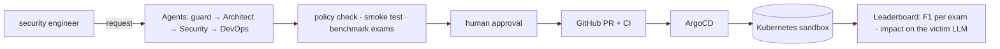

# LLM Sandbox

A lab for building and grading detectors of poisoning attacks against LLM training data.

AI agents write **detectors**: modules that scan a training dataset and flag poisoned samples. Every detector is
graded on **exams** (datasets poisoned on purpose, with hidden answer keys), and its value is shown on the **victim
LLM**: the same model fine-tuned on clean, poisoned and cleaned data. Only detectors that pass every gate and a human
review are merged and deployed through GitOps into an isolated Kubernetes sandbox.



## The two views

| View | What you do there |
|---|---|
| **Leaderboard** | Detectors ranked per threat with F1 on every exam and the pass bar; impact charts (clean / poisoned / cleaned) on the victim LLM; every dataset with its role, source, structure and poisoning recipe; every model with its role; per-detector findings and source code |
| **Agents** | Describe a new detector; follow the pipeline live; review the design, the generated `main.py` and the benchmark; approve to open the pull request; reference for the module contract |

## Results

| What | Result |
|---|---|
| Label-flip detector (kNN in Chroma + confident learning) | F1 0.68 and 0.79 on the label-flip exams |
| Clean-label detector built by the agents | F1 1.00 and 0.94 (hand-written baseline: 1.00 and 0.00) |
| Clean-label backdoor on `HuggingFaceTB/SmolLM2-135M` | attack success 72.0% when poisoned, 9.6% after cleaning, accuracy unchanged (89.2–89.6%) |
| Guard on 116 unseen prompt-injection prompts | precision 1.00, recall 0.80, F1 0.89 |

## Architecture

| Part | Technology | Folder |
|---|---|---|
| Single-page app | Vue 3, TypeScript, Vite, Naive UI, Chart.js | `frontend/` |
| JSON API | FastAPI, Pydantic, SQLAlchemy, Alembic, SQLite | `app/api/`, `app/db/`, `migrations/` |
| Agents | LangGraph, LangChain, Ollama (`qwen2.5-coder:7b`), Chroma RAG | `app/agents/`, `app/rag/`, `knowledge/` |
| Guard | rules, Chroma similarity, LLM judge | `app/guard.py` |
| Sandbox | kind, restricted pods, no egress, one runner image, `sandbox_sdk` | `runner/`, `gitops/infra/`, `modules/` |
| GitOps | ArgoCD app-of-apps + ApplicationSet, GitHub Actions CI | `gitops/`, `.github/` |

API documentation: http://localhost:8000/api/docs

## Quick start

```bash
cp .env.example .env     # add GITHUB_TOKEN (Contents and Pull requests: read and write) for agent PRs
make demo-setup          # about 30 minutes the first time
make dev                 # http://localhost:8000
```

Frontend development with hot reload: `make ui-dev` (http://localhost:5173, proxies `/api` to the backend).
`make help` lists every command; the walkthrough is in [docs/DEMO.md](docs/DEMO.md).

## Building a detector for a new attack

1. Add the threat to `app/sandbox/catalog.py` with its exams, and write its poisoner module (humans write
   poisoners, so agents never grade their own work).
2. Describe the threat and detection ideas in `knowledge/` and run `make ingest`.
3. Ask the agents on the Agents view; review, approve, merge. The leaderboard picks the detector up automatically.

## Learning notes

The step-by-step notes written while building the platform are in [docs/](docs/).
