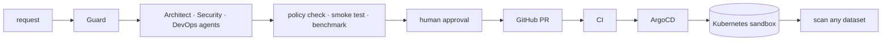

# LLM Sandbox

A vulnerability scanner for LLM training data.

AI agents write **detectors** that find poisoned samples (Label Flipping, Clean-Label backdoors) in datasets used
to fine-tune LLMs. Every new detector must pass automatic exams on data poisoned on purpose, then a human
approval, a GitHub pull request and CI, before ArgoCD deploys it into an isolated Kubernetes sandbox.
A guard blocks prompt-injection attempts against the agents.



## Results

| What | Result |
|---|---|
| Label-flip detector (kNN in Chroma + confident learning) | F1 0.68 and 0.79 on the label-flip exams |
| Clean-label detector built by the agents | F1 1.00 and 0.94 (the hand-written baseline: 1.00 and 0.00) |
| Backdoor impact on SmolLM2-135M | attack success 72% when poisoned, 9.6% after cleaning, accuracy unchanged |
| Guard on 116 unseen prompts | precision 1.00, recall 0.80, F1 0.89 |

## Stack

FastAPI, Jinja2, HTMX, SQLite, SQLAlchemy, Alembic · LangChain, LangGraph, Chroma, Ollama (qwen2.5-coder:7b,
nomic-embed-text) · kind, Kubernetes, ArgoCD, GitHub Actions · PyTorch (CPU), transformers,
sentence-transformers, scikit-learn.

## Quick start

```bash
cp .env.example .env     # add GITHUB_TOKEN to let the agents open pull requests
make demo-setup          # about 30 minutes the first time
make dev                 # http://localhost:8000
```

`make help` lists every command. The 10-minute walkthrough is in [docs/DEMO.md](docs/DEMO.md).

## Learning notes

| Step | Note |
|---|---|
| 0 | [Tools and project skeleton](docs/00-setup.md) |
| 1 | [Web platform and the first LangChain chain](docs/01-platform.md) |
| 2 | [RAG knowledge base](docs/02-rag.md) |
| 3 | [Kubernetes sandbox, runner image, modules](docs/03-sandbox.md) |
| 4 | [GitOps with ArgoCD and CI](docs/04-gitops.md) |
| 5 | [Datasets, poisoners, detectors, benchmark, LLM impact](docs/05-detection.md) |
| 6 | [AI agents with LangGraph](docs/06-agents.md) |
| 7 | [Guard against LLM abuse](docs/07-guard.md) |
