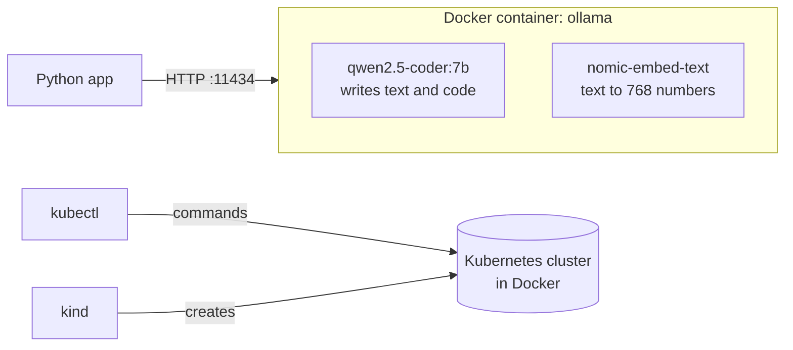

# Step 0 — Tools and project skeleton

## Tools on the laptop

| Tool | Role (simple words) |
|---|---|
| Docker | Runs programs in isolated containers |
| kind | Builds a whole Kubernetes cluster inside one Docker container |
| kubectl | Remote control for the cluster |
| kubeconform | Spell-checker for Kubernetes YAML files |
| uv | Installs Python, creates `.venv`, installs libraries |
| Ollama | Local LLM server (no cloud, no API key) |

## Models

| Model | Size | Used for |
|---|---|---|
| qwen2.5-coder:7b | 4.7 GB | Agents, guard judge (~16 tokens/s on CPU) |
| nomic-embed-text | 274 MB | Embeddings for RAG, guard and search |

## Project files

| File | Purpose |
|---|---|
| `pyproject.toml` / `uv.lock` | Python dependencies and their exact versions |
| `.python-version` | Python 3.12 |
| `Makefile` | Shortcuts (`make help`) |
| `.env.example` | Settings template; copy to `.env` (never committed) |
| `docker-compose.yml` | Runs Ollama |
