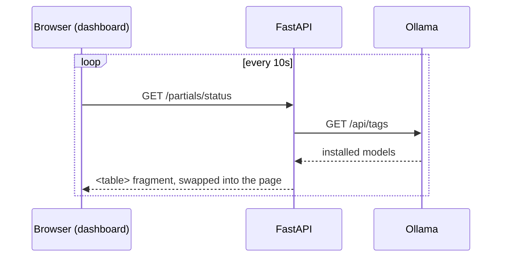
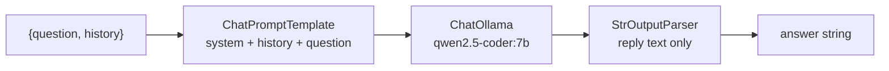
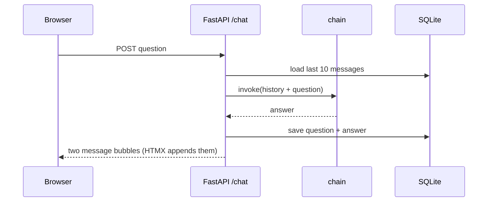

# Step 1 — Platform basics and the first LangChain chain

## Web app

| File | Job |
|---|---|
| `app/config.py` | Settings from `.env` |
| `app/db.py`, `app/models.py` | SQLite via SQLAlchemy |
| `migrations/` | Alembic migrations (one per feature) |
| `app/health.py` | Status checks shown on the dashboard |
| `app/main.py` | Routes |
| `app/templates/` | Jinja pages + HTMX partials |

HTMX lets a part of the page reload itself from the server:



## LangChain in one picture

LangChain gives LLM building blocks that share one interface: `.invoke(input) -> output`.
They are connected with `|`, like Linux pipes.



```python
chain = prompt | chat_model() | StrOutputParser()
answer = chain.invoke({"history": past_messages, "question": "What is label flipping?"})
```

The model has no memory of its own: the last 10 messages are loaded from the `chat_messages`
table and put into the prompt every time. That is why it "remembers".

## Chat request flow


