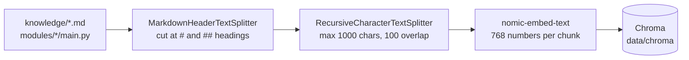
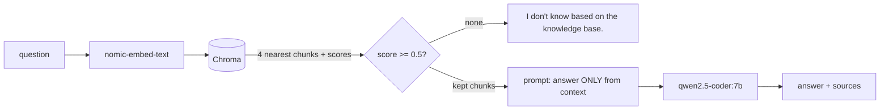

# Step 2 — RAG: an open-book exam for the LLM

The LLM was never trained on this project, so it does not know our rules.
RAG (Retrieval-Augmented Generation) looks up the relevant pages in our own documents
and puts them into the prompt before the LLM answers.

## Two kinds of models

| Model | Input → output | Used for |
|---|---|---|
| `qwen2.5-coder:7b` (writer) | text → text | generating the answer |
| `nomic-embed-text` (meaning-meter) | text → 768 numbers | finding chunks with a similar meaning |

## ① Ingest: fill the library (`make ingest` or the Re-ingest button)

Each chunk is stored with its vector, its text and metadata: `source` (file) and `section` (heading).

## ② Ask: retrieve, augment, generate

## Why a vector database

| SQLite | Chroma |
|---|---|
| finds rows by exact values (`WHERE`, `LIKE`) | finds chunks by closeness of meaning |
| "hidden trigger word" finds nothing | finds "trigger-token scan" (score 0.64) |

Scores measured on this knowledge base: related questions score about 0.65 to 0.7,
unrelated ones ("pizza recipe") about 0.4, so chunks below 0.5 are ignored.

## Troubleshooting: "I don't know" although sources scored above 0.5

Question: "What is forbidden in module code?". The answer said "I don't know" while 4 sources scored about 0.65.

| What we checked | Finding |
|---|---|
| Which chunks were retrieved | Generic intro paragraphs; the chunk with the rules ranked 5th (8th for "permitted"), so it never reached the LLM |
| Why | Its heading was "Code rules for main.py" (not "module code"), it had no "allowed" part, and it was mostly a list of names |
| nomic task labels (`search_query:` / `search_document:`) | Small change, did not fix it |
| Topic header on every chunk | Made it worse |
| **Reworded the section the way people ask** ("what is allowed and what is forbidden in module code") | **Rank 8 → 1 and 5 → 1** |

Lesson: a high score means "related", not "contains the answer". When RAG fails, look at the retrieved
chunks first; the fix is often in the documents, not in the code.

## Where RAG is used later

- Step 6: the AI agents retrieve the module contract, threat notes and existing detector code before writing a new detector.
- Step 7: the guard retrieves known attack prompts that are similar to a new request.
