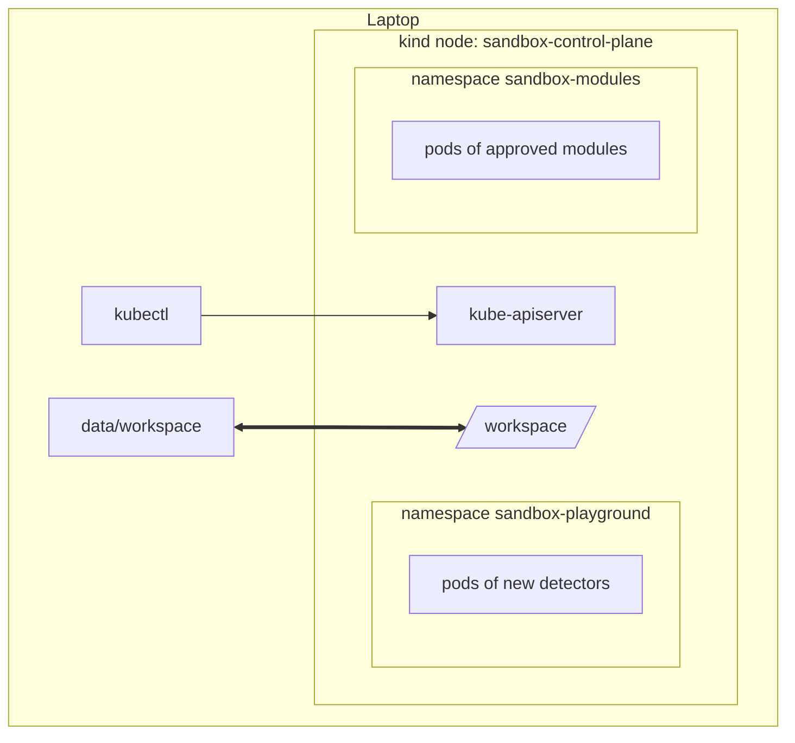
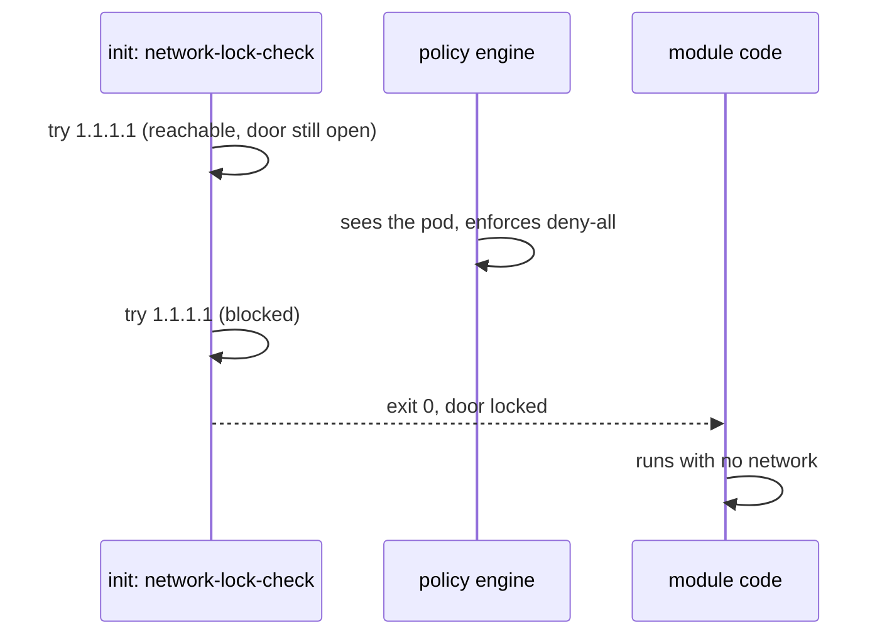

# Step 3 — The Kubernetes sandbox

## Kubernetes as a building

| Word | Simple meaning | In this project |
|---|---|---|
| Cluster | the building | kind cluster `sandbox` |
| Node | a machine in the building | one Docker container `sandbox-control-plane` |
| Namespace | a room with its own rules | `sandbox-playground`, `sandbox-modules` |
| Pod / container | the desk / the program | one module run |
| Job | run once until finished | scans, benchmarks, training |

## The rules of each sandbox room (`gitops/infra/`)

| File | Rule | Simple meaning |
|---|---|---|
| `namespaces.yaml` | Pod Security `restricted` | door guard: no root, no privileges, no host access |
| `network-policies.yaml` | NetworkPolicy `deny-all` | no network in or out |
| `quotas.yaml` | ResourceQuota + LimitRange | CPU/RAM budget per room and per program |
| `storage.yaml` | PersistentVolume + Claim `workspace` | a key to the shared `/workspace` cabinet |

## Proof (tested once with throw-away pods)

| Test | Expected | Result |
|---|---|---|
| curl to the internet from `default` | reachable | HTTP 301 |
| curl to the internet from `sandbox-playground` | blocked | timeout |
| root pod in `sandbox-playground` | refused | Forbidden by PodSecurity |

## Finding: the NetworkPolicy has a start-up gap

The first test showed the sandbox pod reaching the internet. The rule was correct, but the policy engine
(kindnet's kube-network-policies) only enforces it after it has seen the new pod, about 1–2 seconds.
Code that connects immediately at start-up slips through.

Fix: every sandbox pod starts with an init container `network-lock-check`. It runs before the module,
in the same network, and only exits successfully once outbound traffic is blocked (fails closed after 30 s).

In production a CNI such as Calico or Cilium would be used, but the lesson stays the same:
test that a security rule is enforced, do not assume it.
