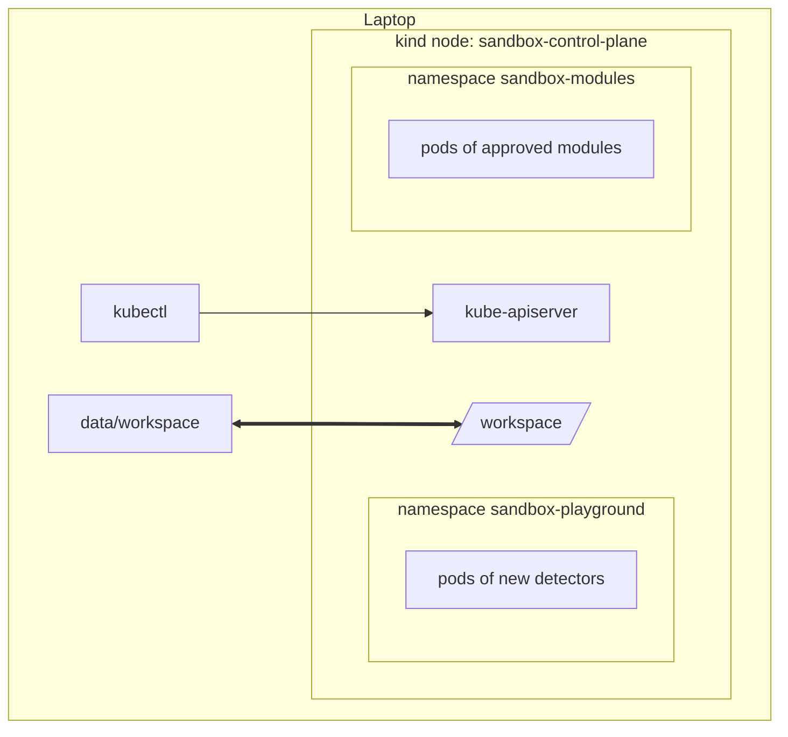
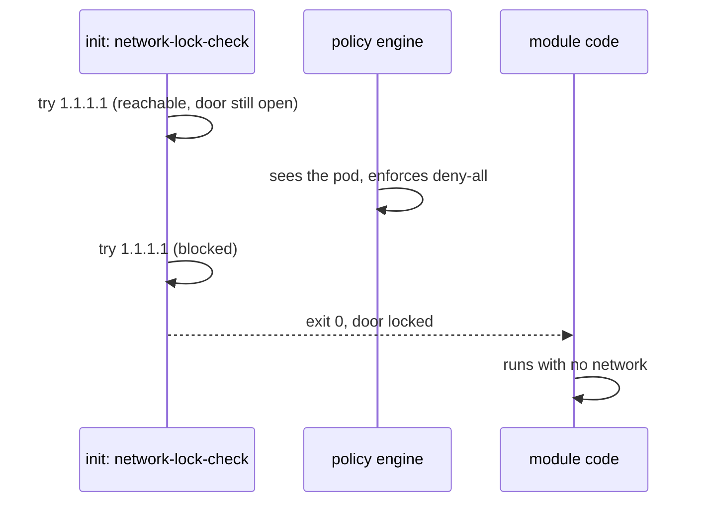
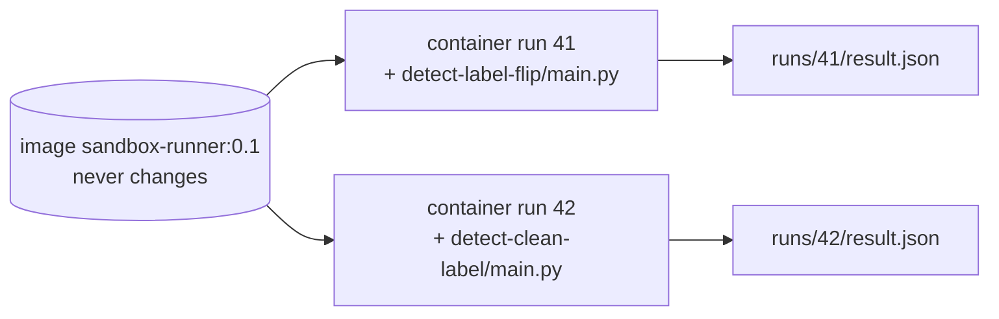
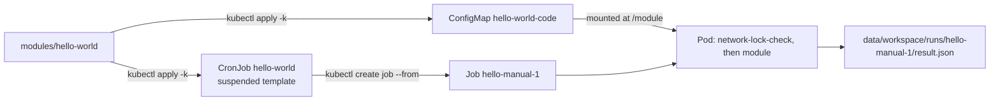

# Step 3 — The Kubernetes sandbox

## Kubernetes as a building

| Word | Simple meaning | In this project |
|---|---|---|
| Cluster | the building | kind cluster `sandbox` |
| Node | a machine in the building | one Docker container `sandbox-control-plane` |
| Namespace | a room with its own rules | `sandbox-playground`, `sandbox-modules` |
| Pod / container | the desk / the program | one module run |
| Job | run once until finished | scans, benchmarks, training |



## The rules of each sandbox room (`gitops/infra/`)

| File | Rule | Simple meaning |
|---|---|---|
| `namespaces.yaml` | Pod Security `restricted` | door guard: no root, no privileges, no host access |
| `network-policies.yaml` | NetworkPolicy `deny-all` | no network in or out |
| `quotas.yaml` | ResourceQuota + LimitRange | CPU/RAM budget per room and per program |
| `storage.yaml` | PersistentVolume + Claim `workspace` | a key to the shared `/workspace` cabinet |

## Proof (tested once with throw-away pods)

| Test | Expected | Result |
|---|---|---|
| curl to the internet from `default` | reachable | HTTP 301 |
| curl to the internet from `sandbox-playground` | blocked | timeout |
| root pod in `sandbox-playground` | refused | Forbidden by PodSecurity |

## Finding: the NetworkPolicy has a start-up gap

The first test showed the sandbox pod reaching the internet. The rule was correct, but the policy engine
(kindnet's kube-network-policies) only enforces it after it has seen the new pod, about 1–2 seconds.
Code that connects immediately at start-up slips through.

Fix: every sandbox pod starts with an init container `network-lock-check`. It runs before the module,
in the same network, and only exits successfully once outbound traffic is blocked (fails closed after 30 s).



In production a CNI such as Calico or Cilium would be used, but the lesson stays the same:
test that a security rule is enforced, do not assume it.

## The runner image and `sandbox_sdk`

The image `sandbox-runner` is a read-only template (Python, torch CPU, transformers, scikit-learn, Chroma,
`sandbox_sdk.py`). It never runs by itself. Every module run is a new, short-lived container created from it,
with the module's `main.py` mounted as a file. In Docker terms one run is:

```bash
docker run --rm --user 1000 --read-only --cap-drop ALL --network none --cpus 1 --memory 1g \
  -v ./modules/detect-label-flip/main.py:/module/main.py:ro \
  -v ./data/workspace/datasets:/workspace/datasets:ro \
  -v ./data/workspace/models:/workspace/models:ro \
  -v ./data/workspace/runs/42:/workspace/run \
  -e PARAMS_JSON='{"dataset": "sst2_suspect_A"}' \
  sandbox-runner:0.1
```



`sandbox_sdk.py` is the only door between a module and the outside: `params()`, `load_dataset()`,
`model_path()`, `log()`, `write_result()`. It rejects path tricks such as `../answers/...`, so a detector
can never read the answer key. Tests: `tests/test_sandbox_sdk.py`.

| docker run flag | Kubernetes equivalent |
|---|---|
| `--rm`, one run | Job |
| `-v main.py` | ConfigMap mounted as a file |
| `-v datasets:ro`, `-v runs/42` | PVC `workspace` with read-only mounts and one writable run folder |
| `--user 1000 --read-only --cap-drop ALL` | securityContext, enforced by Pod Security `restricted` |
| `--network none` | NetworkPolicy `deny-all` + `network-lock-check` |
| `--cpus --memory` | resources + LimitRange + ResourceQuota |

Verified in `sandbox-playground`: user id 1000, root filesystem read-only, datasets read-only,
`result.json` appeared on the laptop in `data/workspace/runs/<id>/`.

## The first module: `modules/hello-world`

| File | Role |
|---|---|
| `main.py` | the program |
| `module.yaml` | ID card and default params (read by `sdk.params()`) |
| `kustomization.yaml` | packs `main.py` + `module.yaml` into a ConfigMap |
| `cronjob.yaml` | the run template (`suspend: true`, never starts by itself) |



```bash
kubectl apply -k modules/hello-world
mkdir -p data/workspace/runs/hello-manual-1
kubectl create job hello-manual-1 --from=cronjob/hello-world -n sandbox-modules
kubectl logs job/hello-manual-1 -n sandbox-modules -c module
```

The run folder must exist before the run: a folder created by Kubernetes belongs to root and the
non-root module could not write to it. The template finds its folder by the job's own name
(`subPathExpr: runs/$(JOB_NAME)`).
