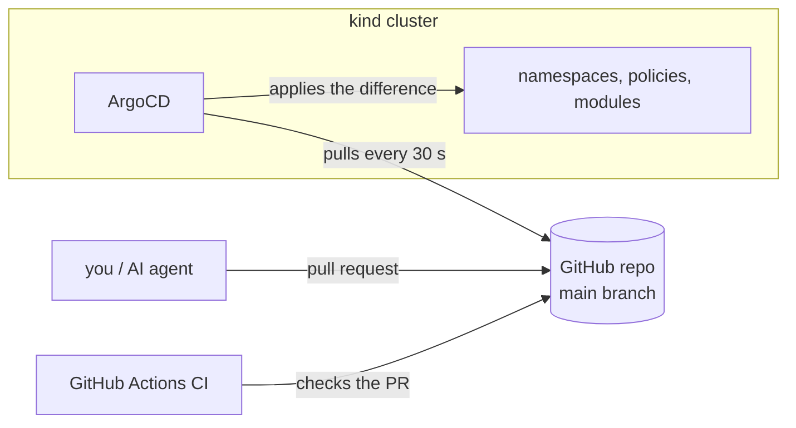
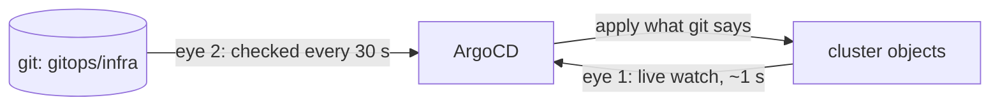
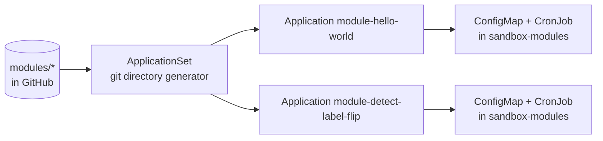
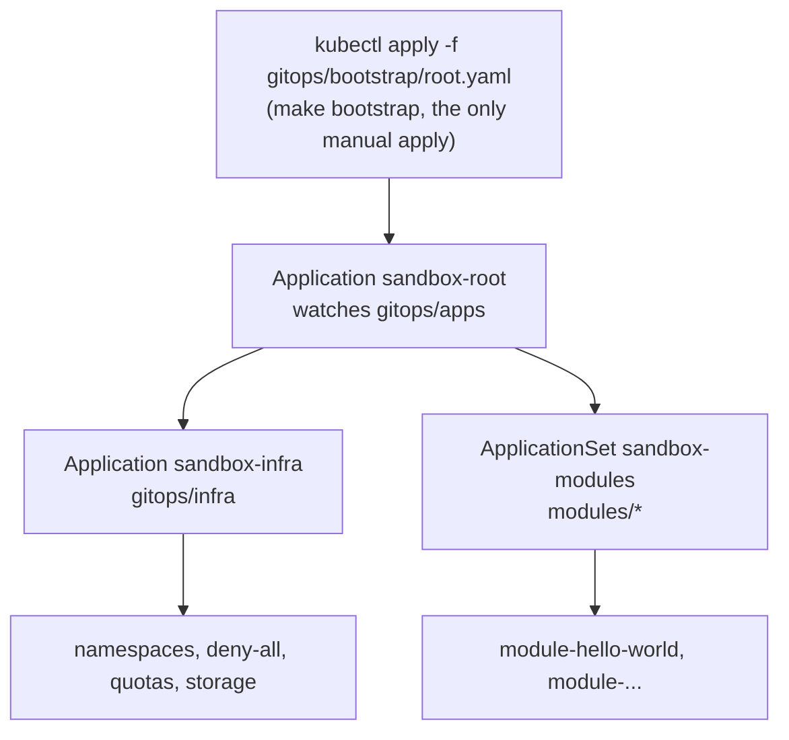
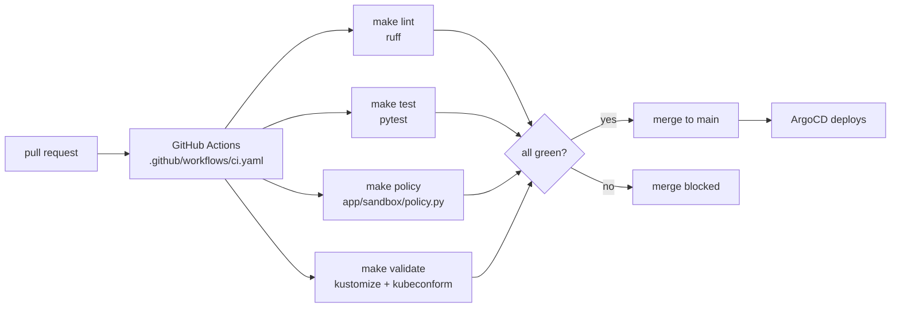

# Step 4 — GitOps with ArgoCD

## The idea

Git is the single blueprint of the cluster. ArgoCD, a program running inside the cluster,
keeps the cluster equal to the blueprint. Nobody (and no AI agent) changes the cluster by hand:
changes go through a pull request, CI checks and a merge.



| Git vs cluster | ArgoCD status | What ArgoCD does |
|---|---|---|
| equal | Synced | nothing |
| git changed (PR merged) | OutOfSync | applies git |
| cluster changed by hand | OutOfSync | restores git (self-heal) |

Push vs pull:

| By hand (Steps 0–3) | GitOps (from Step 4) |
|---|---|
| `kubectl apply` from a laptop | ArgoCD pulls from git |
| no record of who changed what | git history is the audit log |
| manual changes go unnoticed | drift is detected and repaired |
| the AI agents would need cluster admin | the AI agents only open pull requests |

## 4.1 Installing ArgoCD

`gitops/argocd/kustomization.yaml` pins ArgoCD v3.6.1 and lowers the git check interval
from 3 minutes to 30 seconds (`argocd-cm.yaml`).

```bash
make argocd      # install
make argocd-ui   # prints the admin password, then https://localhost:8080 (user admin)
```

| Pod | Job |
|---|---|
| argocd-server | web UI and API |
| argocd-repo-server | clones the git repo and runs kustomize: "what git wants" |
| argocd-application-controller | compares git with the cluster and applies the difference |
| argocd-applicationset-controller | creates Applications automatically (one per module) |
| redis, dex, notifications | cache, login, alerts |

## 4.2 The first Application: `gitops/apps/infra.yaml`

An Application tells ArgoCD: this folder of this repo belongs in this cluster.

```yaml
source:
  repoURL: https://github.com/RuntimeErrorGr/LLMSandbox.git
  targetRevision: main
  path: gitops/infra
syncPolicy:
  automated:
    prune: true
    selfHeal: true
```

| Setting | Meaning |
|---|---|
| `automated` | apply git changes without a manual "Sync" click |
| `selfHeal` | undo manual changes made in the cluster |
| `prune` | delete objects that were removed from git |

ArgoCD adopted the 12 objects created by hand in Step 3.2 (same content, so Synced in 6 seconds).

### Self-heal demo

```
21:00:14  kubectl delete networkpolicy deny-all -n sandbox-playground
21:00:15  deny-all is back, restored by ArgoCD in 1 s
```



## 4.3 ApplicationSet: one Application per module folder

`gitops/apps/modules.yaml` is a card printer: its git generator lists every folder under `modules/`
(checked every 30 s) and prints one Application `module-<folder>` for each.



| Change in git | Result in the cluster |
|---|---|
| new folder `modules/x/` merged | Application `module-x` created, its CronJob deployed |
| `modules/x/main.py` edited | new ConfigMap (new hash), CronJob updated, old ConfigMap pruned |
| folder deleted | Application, CronJob and ConfigMap removed |

This is how AI agents deploy: they add a folder in a pull request; nobody writes ArgoCD config.
Jobs created by the Run button are not in git and are not pruned: ArgoCD shows them under their CronJob.

## 4.4 App-of-apps: one bootstrap command



A new cluster from zero:

```bash
make cluster        # kind cluster
make runner-image   # module toolbox image
make argocd         # install ArgoCD
make bootstrap      # ArgoCD builds everything else from git
```

Module apps retry their sync (up to 10 times, 10 s to 3 min apart), because on a fresh cluster
they can start before the `sandbox-modules` namespace exists.

## 4.5 CI: GitHub Actions checks every push and pull request

CI checks a change, CD (ArgoCD) delivers it. A red CI blocks the merge, so nothing broken reaches the cluster.



`make ci` runs the same four checks on the laptop.

### The policy checker (`app/sandbox/policy.py`)

| File | Rules |
|---|---|
| `main.py` | no socket, subprocess, requests, urllib, http, ctypes, multiprocessing imports; no eval, exec, compile, `__import__`, os.system/popen/exec/spawn; at most 400 lines; must use `sandbox_sdk` and call `write_result` |
| `module.yaml` | name equals the folder name; kind is detector, poisoner, trainer or example; threat is set |
| `kustomization.yaml` | namespace sandbox-modules; packs `main.py` and `module.yaml` into `<name>-code` |
| `cronjob.yaml` | suspended; runner image only; non-root user 1000; read-only root filesystem; drop ALL capabilities; no privileged, hostNetwork, hostPID, hostPath; network lock check first; CPU/RAM requests and limits (at most 4 CPU, 6Gi); deadline at most 1800 s; backoffLimit 0 |

The same checker runs in the agent pipeline (Step 6) before a pull request is opened, and again in CI.
`tests/test_policy.py` breaks hello-world in 13 ways and expects each one to be caught.
