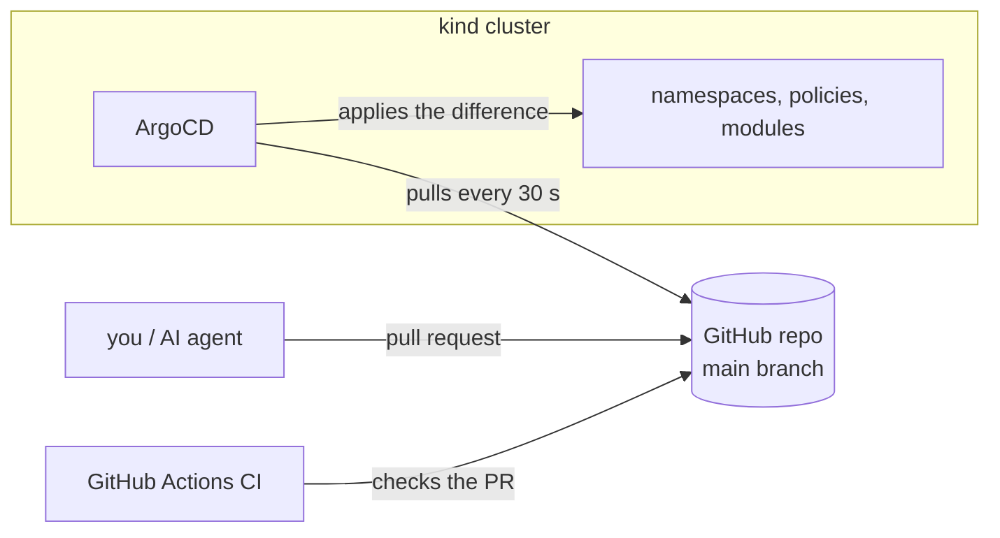
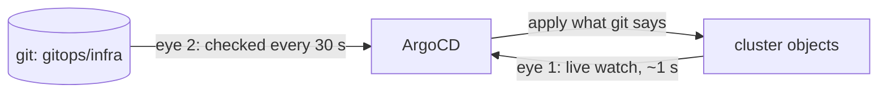

# Step 4 — GitOps with ArgoCD

## The idea

Git is the single blueprint of the cluster. ArgoCD, a program running inside the cluster,
keeps the cluster equal to the blueprint. Nobody (and no AI agent) changes the cluster by hand:
changes go through a pull request, CI checks and a merge.



| Git vs cluster | ArgoCD status | What ArgoCD does |
|---|---|---|
| equal | Synced | nothing |
| git changed (PR merged) | OutOfSync | applies git |
| cluster changed by hand | OutOfSync | restores git (self-heal) |

Push vs pull:

| By hand (Steps 0–3) | GitOps (from Step 4) |
|---|---|
| `kubectl apply` from a laptop | ArgoCD pulls from git |
| no record of who changed what | git history is the audit log |
| manual changes go unnoticed | drift is detected and repaired |
| the AI agents would need cluster admin | the AI agents only open pull requests |

## 4.1 Installing ArgoCD

`gitops/argocd/kustomization.yaml` pins ArgoCD v3.6.1 and lowers the git check interval
from 3 minutes to 30 seconds (`argocd-cm.yaml`).

```bash
make argocd      # install
make argocd-ui   # prints the admin password, then https://localhost:8080 (user admin)
```

| Pod | Job |
|---|---|
| argocd-server | web UI and API |
| argocd-repo-server | clones the git repo and runs kustomize: "what git wants" |
| argocd-application-controller | compares git with the cluster and applies the difference |
| argocd-applicationset-controller | creates Applications automatically (one per module) |
| redis, dex, notifications | cache, login, alerts |

## 4.2 The first Application: `gitops/apps/infra.yaml`

An Application tells ArgoCD: this folder of this repo belongs in this cluster.

```yaml
source:
  repoURL: https://github.com/RuntimeErrorGr/LLMSandbox.git
  targetRevision: main
  path: gitops/infra
syncPolicy:
  automated:
    prune: true
    selfHeal: true
```

| Setting | Meaning |
|---|---|
| `automated` | apply git changes without a manual "Sync" click |
| `selfHeal` | undo manual changes made in the cluster |
| `prune` | delete objects that were removed from git |

ArgoCD adopted the 12 objects created by hand in Step 3.2 (same content, so Synced in 6 seconds).

### Self-heal demo

```
21:00:14  kubectl delete networkpolicy deny-all -n sandbox-playground
21:00:15  deny-all is back, restored by ArgoCD in 1 s
```


