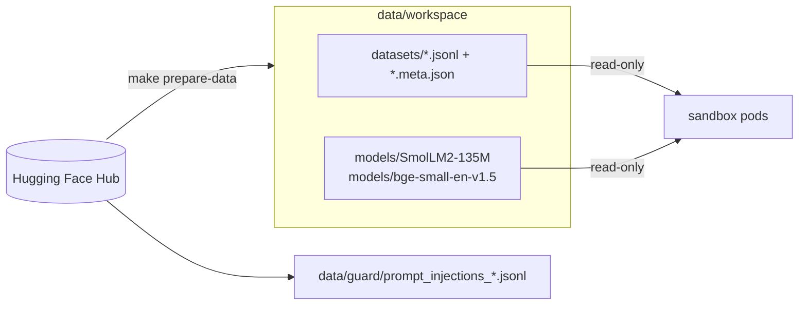
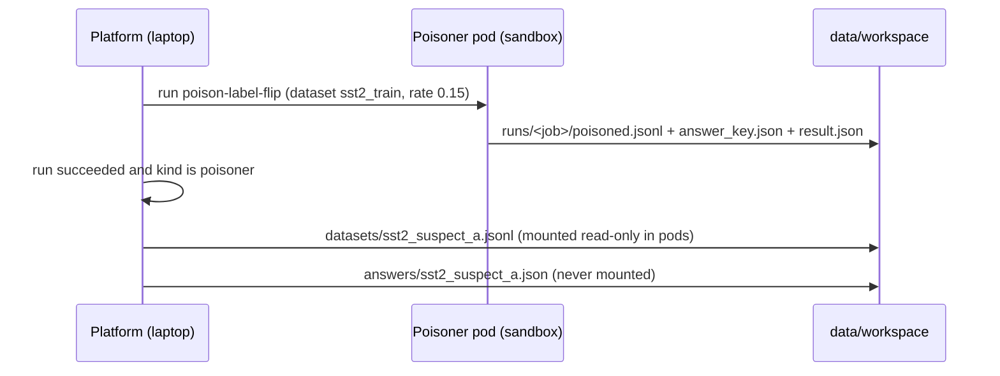
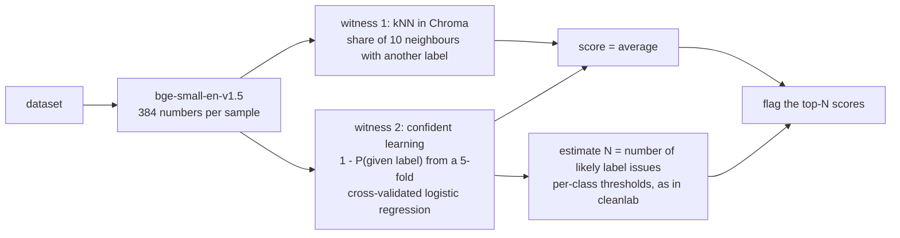

# Step 5 — Datasets, poisoners, detectors and the benchmark

## 5.1 Clean data and models (`make prepare-data`)

`app/workspace/prepare.py` runs on the laptop (it has internet) and writes everything in the
module contract format. Sandbox pods only read these files and never download anything.

| File | Samples | Labels | Used for |
|---|---|---|---|
| `sst2_train` | 2,000 (1,000 per label, at least 6 words) | negative, positive | main clean dataset, poisoned in 5.2 and 5.3 |
| `sst2_test` | 872 | negative, positive | accuracy and attack success of the victim LLM |
| `agnews_train` | 2,000 (500 per topic) | World, Sports, Business, Sci/Tech | second clean dataset (multi-class) |
| `agnews_test` | 1,000 | same | evaluation |
| `prompt_injections_train/test` (in `data/guard/`) | 546 / 116 | benign, injection | the guard (Step 7), not mounted in pods |

| Model | Size | Role |
|---|---|---|
| `bge-small-en-v1.5` | 128 MB | sentence embeddings (384 numbers) inside detectors |
| `SmolLM2-135M` | 260 MB | the victim LLM, fine-tuned in the impact test |

Sample row: `{"id": 2, "text": "it is ok for a movie to be something of a sitcom apparatus , ...", "label": 1}`

Checked: both models load in the runner image with `--network none`, as user 1000, read-only.
The poisoned demo files are not made here: the poisoner modules create them in 5.2 and 5.3.

## 5.2a The poisoner `poison-label-flip`

Flips the labels of `rate` of the samples (random mode: to any other label; targeted mode: from
`source_label` to `target_label`) and writes the ids it changed into a secret answer key.

Rules in `app/sandbox/datasets.py: publish_poisoned()`: lowercase safe names only, never overwrite a clean
dataset, only modules of kind `poisoner` are published.

Checked in a locked-down container: 300 of 2,000 labels flipped, answer key equals the real changes.

`make demo-targets` creates `sst2_suspect_a` (15% flipped) and `agnews_suspect_c` (10% flipped)
by running the real poisoner in the sandbox.

## 5.2b The detector `detect-label-flip`

A flipped label disagrees with everything around it. Two independent witnesses score every sample:

Example: "is a remarkably original work ." labelled negative, score 0.97,
"10 of 10 neighbours say 'positive'; classifier gives 6% to 'negative'".

### How it was tuned against the answer keys

| Version | sst2_suspect_a F1 | agnews_suspect_c F1 |
|---|---|---|
| MiniLM embeddings, fixed threshold 0.5 | 0.47 | 0.53 |
| MiniLM, best fixed threshold per dataset | 0.54 | 0.79 |
| bge-small, top-N with estimated N (final) | **0.72** | **0.80** |
| final, on the clean `sst2_train` | 56 of 2,000 flagged (2.8%) | |

Lessons: MiniLM captures topic, not sentiment (70% accuracy on SST-2), so the embedding model was the
bottleneck, not the formula. A fixed threshold only fits one dataset; estimating N from the data works
on both without tuning. A model fine-tuned on the scanned dataset must never be used: it knows the true labels.
