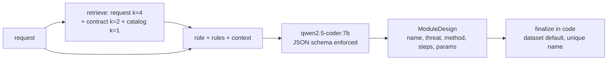
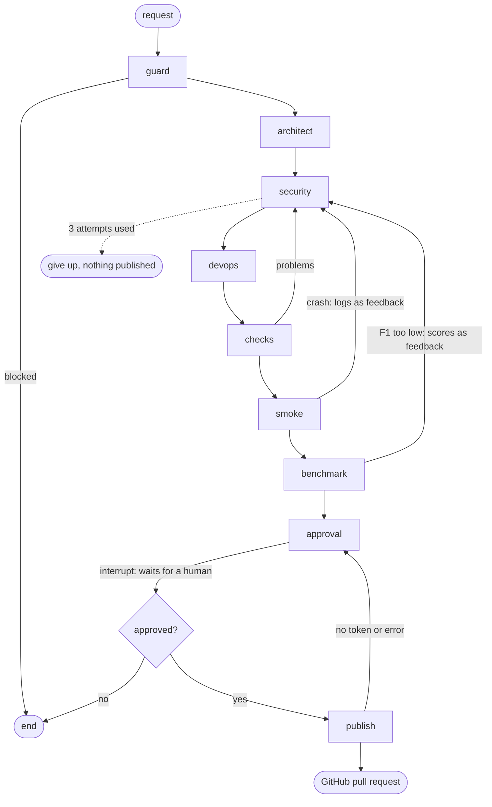

# Step 6 — AI agents that build detectors

## What an agent is

An agent is an LLM wrapped with four things:

| Part | In the Architect |
|---|---|
| role | system prompt: "You are the Architect agent... Rules: ..." |
| knowledge | RAG: focused chunks of `knowledge/*.md` and existing module code |
| brain | `qwen2.5-coder:7b` in Ollama |
| output contract | `ModuleDesign` (Pydantic), enforced with `.with_structured_output(...)` |



## 6.1 The Architect (`app/agents/architect.py`, Build page)

Tuning story on the request "natural-word triggers using outlier statistics":

| Try | Problem | Fix |
|---|---|---|
| 1 | z-score of word frequency (would flag "the"); default dataset an exam | knowledge made precise (label-surprise z); dataset default set in code |
| 2 | copied method 1 (the baseline that scores 0.00) | 15 chunks was too much context; the outlier idea was under "Other ideas" |
| 3 | correct design, 70 s instead of 2 min | 7 focused chunks, "Detection method 3" section, rule "design exactly the requested method" |

Principles: rules that must always hold go in code (`finalize()`), not only in the prompt;
when an agent is wrong, check what context it received before changing the prompt.

## 6.2 to 6.5 The LangGraph pipeline (`app/agents/graph.py`)

LangGraph runs a graph of nodes that share one state dictionary (`BuildState`). Every node returns the
fields it changed; conditional edges decide where to go next; a checkpointer saves the state after each
node in `data/agents.db`, so a run can pause for approval or continue after a restart.



| Node | Kind | What it does |
|---|---|---|
| guard | code + LLM | rules, similarity, LLM judge (Step 7) |
| architect | LLM | `ModuleDesign` from focused RAG context |
| security | LLM | writes `main.py`; gets the previous code and the feedback on retries; comments are stripped |
| devops | LLM + templates | `DeploymentSpec`, clamped to sandbox limits, rendered into hardened templates |
| checks | code | policy checker + `ruff --select F,E9` (undefined names, syntax) |
| smoke | sandbox | module deployed to `sandbox-playground` (no git), run with `SMOKE_TEST=1` on 50 samples |
| benchmark | sandbox | `run_benchmark(name, playground)` on every exam of the threat |
| approval | human | `interrupt()`; Approve / Reject on the Build page |
| publish | code | own clone `data/agent-repo`, branch `agent/<name>-<id>`, push with the token, open the PR |

### Result: "natural-word triggers using outlier statistics"

```
12:30:24 guard      request allowed
12:30:47 architect  designed detect-clean-label-natural-triggers from 7 knowledge chunks
12:33:16 security   attempt 1: wrote main.py (85 lines)
12:33:54 devops     cpu 1, memory 512Mi
12:33:54 checks     policy and static checks passed
12:34:03 smoke      passed in the playground
12:34:11 benchmark  exam_cl_rare F1 1.00, exam_cl_natural F1 0.938  (reference token scan: 0.00)
```

What a reviewer should notice before approving: `compute_median_and_mad()` is defined but never used
(dead code), and the code uses the plain label-surprise z >= 6 instead of the robust z of the design.
It still passes because no clean word reaches z 6 on SST-2. This is why the pipeline ends with a human.

### Result: "spectral signatures" (the failure case)

```
12:38:21 checks     F821 undefined name `torch`             → back to security
12:40:45 smoke      crashed: tried to download from huggingface.co (no internet in the sandbox)
12:43:26 smoke      crashed again with the same error
12:43:26 security   gave up after 3 attempts; nothing was published
```

### Lessons from the first runs

| Problem seen | Gate that catches it | Fix in the platform |
|---|---|---|
| `re` used without import, `params` used outside `main()` | static check (pyflakes rules) | two extra rules in the Security prompt |
| wrong method copied from the knowledge base | benchmark | focused retrieval, precise knowledge, "design exactly the requested method" |
| exam chosen as default dataset | code | `finalize()` sets the demo dataset |
| resources above the sandbox limits | code | `clamp()` before rendering |
| model loaded by hub name (needs internet) | smoke test (the sandbox has no network) | rule: models only via `sdk.model_path` |
