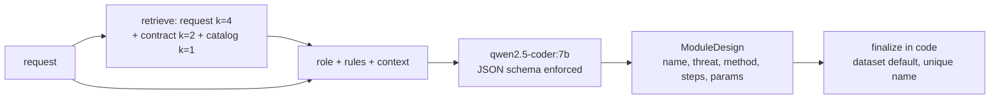

# Step 6 — AI agents that build detectors

## What an agent is

An agent is an LLM wrapped with four things:

| Part | In the Architect |
|---|---|
| role | system prompt: "You are the Architect agent... Rules: ..." |
| knowledge | RAG: focused chunks of `knowledge/*.md` and existing module code |
| brain | `qwen2.5-coder:7b` in Ollama |
| output contract | `ModuleDesign` (Pydantic), enforced with `.with_structured_output(...)` |

## 6.1 The Architect (`app/agents/architect.py`, Build page)

Tuning story on the request "natural-word triggers using outlier statistics":

| Try | Problem | Fix |
|---|---|---|
| 1 | z-score of word frequency (would flag "the"); default dataset an exam | knowledge made precise (label-surprise z); dataset default set in code |
| 2 | copied method 1 (the baseline that scores 0.00) | 15 chunks was too much context; the outlier idea was under "Other ideas" |
| 3 | correct design, 70 s instead of 2 min | 7 focused chunks, "Detection method 3" section, rule "design exactly the requested method" |

Principles: rules that must always hold go in code (`finalize()`), not only in the prompt;
when an agent is wrong, check what context it received before changing the prompt.
