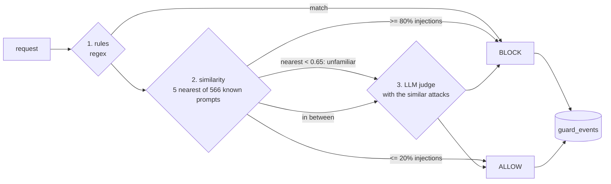

# Step 7 — The guard against LLM abuse (`app/guard.py`)

Every request to the agents passes the guard first (node 1 of the pipeline). It also has its own page.

| Layer | Cost | Catches |
|---|---|---|
| rules | microseconds | instruction override (EN and DE), role-play jailbreaks, prompt extraction, malicious code, sandbox escape, reading answer keys |
| similarity | about 0.1 s | prompts close to the 546 labelled examples of `deepset/prompt-injections` plus 20 in-domain examples |
| LLM judge | about 5 s | unfamiliar or unclear prompts; structured verdict `{verdict, category, reason}` |

## Tuning against the test split (116 unseen prompts)

| Version | Precision | Recall | F1 | Our own requests |
|---|---|---|---|---|
| first try | 1.00 | 0.63 | 0.78 | legitimate "Build a detector..." requests BLOCKED |
| + minimum similarity 0.65, in-domain examples, rule stems | 1.00 | 0.48 | 0.65 | all correct |
| + generic rules (forget/ignore, "act as", German), judge told about hidden second tasks | **1.00** | **0.80** | **0.89** | all correct |

Lesson: the public dataset is about other topics, so for this platform's requests the nearest neighbours
were far away (similarity 0.52 to 0.58) and their vote meant nothing. The similarity layer now only decides
when a known prompt is genuinely close; everything unfamiliar goes to the judge.
